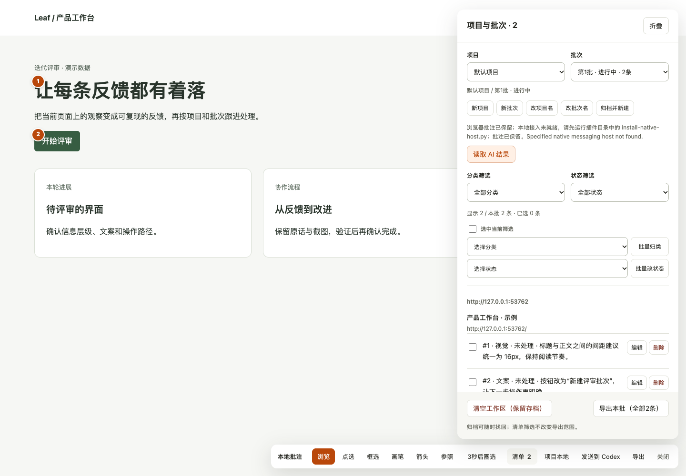

# Kepler Annotate · 开普勒网页批注

在网页上点选元素、圈选区域、画箭头并写下反馈，将原话、页面线索和截图按项目与批次保存在本地。既可导出 ZIP 交给协作者，也可通过可选的本地主机同步到 Git 项目，让 AI 查询增量、逐项修改并回写待验收结果。



## 能做什么

- **直接在网页上批注**：点选元素、框选区域、画笔和箭头，保存截图并附参考图；分别记录实际表现、预期结果和复现步骤。
- **给浮层定格**：用“3秒后圈选”展开菜单、提示或弹层，再在定格画面上标记；也可用 `Alt+Shift+S` 立即定格，`Esc` 恢复交互。
- **分类处理反馈**：视觉、文案、交互、产品逻辑、反馈/建议；支持分类与状态筛选、批量归类和批量改状态。
- **按项目管理批次**：跨页面收集同批反馈，切换历史批次、归档并新建，或继续已有批次；清空工作区会保留存档。
- **完整交接**：ZIP v1 保留原始批次、结构化 AI 任务、可读说明、截图和参考图；清单筛选不缩减导出范围。
- **可选项目同步**：绑定本地 Git 根目录后，保存与批次管理会自动同步；CLI 和 Skill 可查询新增、修改及删除，并按条目精确版本回写处理结果。
- **人工验收**：AI 结果与用户状态分开显示；AI 改完写“待验收”，用户确认后再设为“已完成”。

## 支持范围

| 能力 | 范围 |
| --- | --- |
| 浏览器批注 | Chrome 116 及以上的普通网页，Manifest V3，点击图标后按需注入 |
| 受限页面 | Chrome 内置页面、扩展商店及内置 PDF 阅读器不支持批注 |
| 本地文件页面 | 需在扩展详情中手动允许访问文件网址，仍受 Chrome 页面限制 |
| macOS 本地主机 | 已验证 Native Messaging 项目同步及本地 CLI 链路 |
| Linux 本地主机 | 默认浏览器注册尚未提供，实机链路待验证；单元测试不代表安装与通信已验收 |
| Windows 本地主机 | 暂未支持；Python 实现依赖 POSIX `fcntl` 与 `O_NOFOLLOW`，不属于可直接移植的脚本 |

浏览器批注、截图、批次管理与 ZIP 导出无需安装 Python 主机或 AI 工具。Chromium 系浏览器的完整兼容性需分别验证。

## 安装 Chrome 扩展

```sh
git clone https://github.com/wcy8822/kepler-annotate.git
cd kepler-annotate
```

1. 在 Chrome 地址栏打开 `chrome://extensions`，开启“开发者模式”。
2. 点击“加载已解压的扩展程序”，选择本仓库根目录，即包含 `manifest.json` 的目录。
3. 将扩展固定到工具栏，在普通网页点击图标打开批注；也可使用 `Alt+Shift+A`，快捷键以 Chrome 设置为准。
4. 点选元素或圈选区域，填写反馈并保存；在“清单”中管理项目、批次、分类和状态。
5. 点击“导出”备份本批全部条目。更新源码后，在扩展管理页点“重新加载”，再刷新目标网页。

扩展运行资源已包含在仓库中，加载扩展无需先运行 npm 构建。

### 更新已有安装，保留数据

本 GitHub 仓库是源码与迭代的统一入口。每次更新先在开发分支实现、测试并同步 GitHub，再更新本地安装；交付时优先提供仓库、分支或提交链接，便于其他 AI 拉取复核。

已经加载在 Chrome 中的扩展应保持原安装目录，避免加载到新目录后生成不同扩展 ID。先取得已验证的源码版本，再原位复制运行文件：

```sh
# 在本仓库根目录；INSTALLED_EXTENSION_ROOT 是原先加载的目录。
python3 scripts/update-installed.py --target "$INSTALLED_EXTENSION_ROOT"
```

脚本先备份原运行文件，再更新白名单内的扩展文件，并输出本地备份位置；原生主机配置、启动器、用户数据与其他文件保留。脚本不操作 Chrome，也不读取或迁移浏览器资料。完成后在 `chrome://extensions` 点击原扩展的“重新加载”，再刷新要批注的网页；保存正在编辑的草稿后再执行这一步。核对扩展 ID、项目、批次、批注和图片，并验证保存与导出。修改运行文件与让 Chrome 重新加载是两个独立步骤。

源码回退也沿用相同安装目录和备份；请保留备份及 ZIP，避免通过卸载扩展来更新。

## 数据与隐私

批注元数据保存在扩展的 `chrome.storage.local`，图片保存在扩展 IndexedDB；没有内置云上传服务，也没有后台常驻 AI。Manifest V3 服务工作线程负责浏览器事件和本地存取，与持续运行的 AI 代理不同。

可选主机通过 Chrome Native Messaging 接收消息，在绑定项目的 `.kepler-annotate/` 保存快照和处理结果，并在本地主机数据目录保存项目注册信息与显式直送的交接资料。绑定会向目标 Git 仓库的本地 `info/exclude` 加入 `/.kepler-annotate/`，方便将原始资料留在本机；忽略规则不是加密或访问控制。

点击“发送到 Codex”是显式直送：批次先保存到本机，再经 `codex queue` 排入你选择的 AI 对话，由该对话读取本地资料。后续数据处理受所选 AI 工具、模型和对话配置影响；插件没有云上传，并不代表所选 AI 服务完全离线。普通查询与结果回写不发送对话消息。

截图可能包含整个可见画面的内容，批次还会包含网址、页面标题、元素文字、原话和参考图。导出或交给 AI 前请核对内容、授权与脱敏；备份也应妥善保管。卸载扩展或清理浏览器数据可能丢失浏览器副本；先导出需要保留的批次。归档只保存在本地，不等于异地备份。

权限、信任边界和安全反馈方式见 [安全说明](SECURITY.md)。

## 可选：安装 Python 本地主机

以下安装方式面向 macOS，需要 Python 3 与 Git。Python 主机使用标准库，无需安装 pip 包。Linux 的默认浏览器注册尚未实现，其他 POSIX 平台仅可用 `--config-root` 测试 macOS 注册布局，不能视为 Linux 安装支持。请保留仓库位置；注册配置会引用该目录，移动后需重新安装。

先在 Chrome 扩展详情页复制当前扩展 ID，再在仓库根目录运行：

```sh
python3 install-native-host.py --help
python3 install-native-host.py --extension-id EXTENSION_ID
```

| 参数 | 用途 |
| --- | --- |
| `--extension-id EXTENSION_ID` | 必填，使用本机当前加载的扩展 ID，注册允许连接的扩展来源 |
| `--codex-path CODEX_PATH` | 可选；默认从 `PATH` 查找 Codex，也可显式指定可执行文件。仅项目同步时无需 Codex |
| `--thread THREAD_ID` | 可选；省略时读取 `CODEX_THREAD_ID`，环境变量未设置或为空时不预设目标。仅供显式直送使用，项目同步、查询和结果回写无需对话 ID |
| `--config-root CONFIG_ROOT` | 隔离安装配置，用于测试；普通安装省略 |

需要指定 Codex 可执行文件时，可在已将其加入 `PATH` 的终端运行：

```sh
python3 install-native-host.py --extension-id EXTENSION_ID --codex-path "$(command -v codex)"
```

需要预设直送目标时，在安装命令末尾加 `--thread THREAD_ID`；也可稍后在插件“发送到 Codex”面板选择目标。若当前环境已设置 `CODEX_THREAD_ID`，可显式传入 `--thread ''` 来安装为无默认目标；非空值须为有效 UUID。直送依赖支持 `queue --thread … --message …` 的 Codex 命令行工具，不同工具版本应先核对其帮助。

安装器仅为 macOS 的 Chrome、Chrome for Testing（注册目录 `Google/ChromeForTesting`）和 Chromium 注册 `com.kepler.annotate`，写入本地 `native-host-config.json`、`native-host-launcher` 和浏览器 Native Messaging 配置。启动器使用安装时的 Python 解释器，已有普通配置文件会保留备份。扩展 ID 或解释器位置变化后重新安装。配置、启动器与备份含本地路径和可选目标信息，请留在本机。

在插件“项目本地”中，亲自填写目标 Git 项目根目录，点击“绑定并同步项目”。之后可用“同步当前批次”和“读取 AI 结果”检查状态；同步故障时浏览器副本继续保留。

## CLI：查询和回写

下列命令均在插件仓库根目录运行。大写参数是占位符，请替换为实际查询值；本地路径通过环境变量或当前目录生成，勿复制为公开示例数据。

```sh
python3 kepler-annotations.py --help
python3 kepler-annotations.py projects
python3 kepler-annotations.py batches --project PROJECT_ID
python3 kepler-annotations.py read --project PROJECT_ID --batch BATCH_ID
python3 kepler-annotations.py read --project PROJECT_ID --batch BATCH_ID --since CURSOR
```

也可通过 CLI 绑定：先将 `PROJECT_ROOT` 设置为用户明确指定的目标 Git 根目录，再执行：

```sh
python3 kepler-annotations.py bind --project PROJECT_ID --path "$PROJECT_ROOT" --name '示例项目'
```

`read` 返回批次级 `cursor`，单条的 `items[].revision` 是结果回写使用的条目版本。保存 `cursor`，下次通过 `--since` 获取新增、修改与删除。详见 [AI 工作流](docs/AI-WORKFLOW.md)。

```sh
python3 kepler-annotations.py result --project PROJECT_ID --batch BATCH_ID --id ORIGINAL_ID --revision ITEM_REVISION --status 待确认 --summary '预期行为需要用户确认'
```

实施、测试并按目标项目规则提交后，才能登记“待验收”。`checks.json` 使用真实执行记录，格式为 `[{"command":"实际运行的命令","exitCode":0}]`：

```sh
python3 kepler-annotations.py result --project PROJECT_ID --batch BATCH_ID --id ORIGINAL_ID --revision ITEM_REVISION --status 待验收 --summary '具体改动、验证结论与遗留事项' --branch codex/FEATURE --commit COMMIT_SHA --checks-file "$CHECKS_FILE" --requirements "$REQUIREMENTS_FILE"
```

将 `CHECKS_FILE` 和 `REQUIREMENTS_FILE` 设置为本地证据文件路径。`--requirements` 只登记路径，不代写或读取需求文件。“待验收”要求存在的 `codex/` 分支、该分支包含的本仓提交，以及非空且全部成功的检查记录。原条目已修改或删除时，旧版本回写会被拒绝，需重新读取；同批其他条目新增不会使未变条目的结果失效。

## 可选：安装 AI Skill

将 [Skill 目录](skill/kepler-annotations) 软链到 AI 工具支持的技能目录。以下采用通用的用户技能目录；若所用工具目录不同，请调整 `SKILL_ROOT`：

```sh
# 在插件仓库根目录运行。
PLUGIN_ROOT="$PWD"
SKILL_ROOT="$HOME/.agents/skills"
mkdir -p "$SKILL_ROOT"
ln -s "$PLUGIN_ROOT/skill/kepler-annotations" "$SKILL_ROOT/kepler-annotations"
python3 "$SKILL_ROOT/kepler-annotations/scripts/kepler_annotations.py" --help
```

若目标已存在，先核对已有安装再处理，保留现有技能。软链使包装脚本找到仓库中的唯一 CLI 实现；保持源仓库位置稳定。根据 AI 工具要求刷新或重开会话，再让它读取指定项目、批次的批注。安装 Skill 不会自动开始任务，操作范围仍由用户授权。

## 目录与契约

| 路径 | 职责 |
| --- | --- |
| [manifest.json](manifest.json) | MV3 权限、版本和入口 |
| [service-worker.js](service-worker.js) | 点击注入、存储事务、截图与 Native Messaging |
| [kp-annotate.js](kp-annotate.js)、[kp-annotate.css](kp-annotate.css) | 批注界面、绘图、定格与清单 |
| [kp-annotate-store.js](kp-annotate-store.js) | 浏览器存储接口、AI 任务和 ZIP 导出 |
| [kp-annotate-project.js](kp-annotate-project.js) | 项目绑定、同步与 AI 结果展示 |
| [install-native-host.py](install-native-host.py)、[native-host.py](native-host.py) | 本地主机安装、消息校验及显式直送 |
| [project_store.py](project_store.py)、[kepler-annotations.py](kepler-annotations.py) | 项目快照、增量查询和精确版本结果登记 |
| [skill/kepler-annotations](skill/kepler-annotations) | AI 消费批注的技能及 CLI 包装脚本 |
| [tests](tests) | Node/Python 单元测试、UI 与隔离端到端检查 |
| [vendor/jszip.LICENSE](vendor/jszip.LICENSE) | 随包 JSZip 的第三方许可 |

ZIP v1 含 `annotations.json`（`schemaVersion: 1`）、`annotations.md`、`ai-tasks.json`、`AI-README.md`，以及被引用的 `shots/`、`refs/` 图片。图片路径相对批次，任务的稳定 `key` 由项目、批次、原条目编号组成；分类、原话和证据必须保留。缺失字段由 `null` 和 `missingInformation` 表示，不补造业务结论。变更契约时须兼顾历史批次、导出、主机、CLI 与 Skill。

## 开发与检查

V1.5 的 AI 前端评审正在按独立改动推进，路线与状态见 [AI 评审迭代计划](docs/AI-REVIEW-V1.5.md)，实验性任务格式见 [评审任务契约](docs/AI-REVIEW-CONTRACT.md)。当前浏览器仍生成 v1 任务，尚无圈选时即时 AI 建议。新增 v2 的结构化保存与读取保护不代表已支持模型调用或已验证用户批准来源，版本仍为 v1.4.0。

开发需要 Node.js 22 及以上、Python 3 和 Git；CI 使用 Python 3.12。运行已有检查：

```sh
npm ci
npm test
npm run browsers:install
npm run test:ui
npm run test:e2e
npm run test:design
npm run check:public
```

`npm test` 包含 Node 与 Python 测试。UI 与端到端脚本需要 Playwright Chromium，使用隔离临时目录；测试产物可能含本地路径，请在分享前检查。`KEPLER_TEST_PYTHON` 可指定 Python，`KEPLER_E2E_CHROME` 可指定测试浏览器。Linux CI 的单元测试范围与 macOS Native Messaging 实机验收应分别记录。

贡献请先读 [贡献指南](CONTRIBUTING.md)；使用 AI 开发插件请同时读 [AGENTS.md](AGENTS.md)。安全问题见 [SECURITY.md](SECURITY.md)。

## 许可

本项目采用 [MIT 许可](LICENSE)，版权声明为 `2026 Kepler Annotate contributors`。随包 JSZip 保留其独立的 [第三方许可](vendor/jszip.LICENSE)，其中提供 MIT 或 GPLv3 许可选择；分发时须保留对应许可及版权声明，项目 MIT 许可不替代第三方声明。
